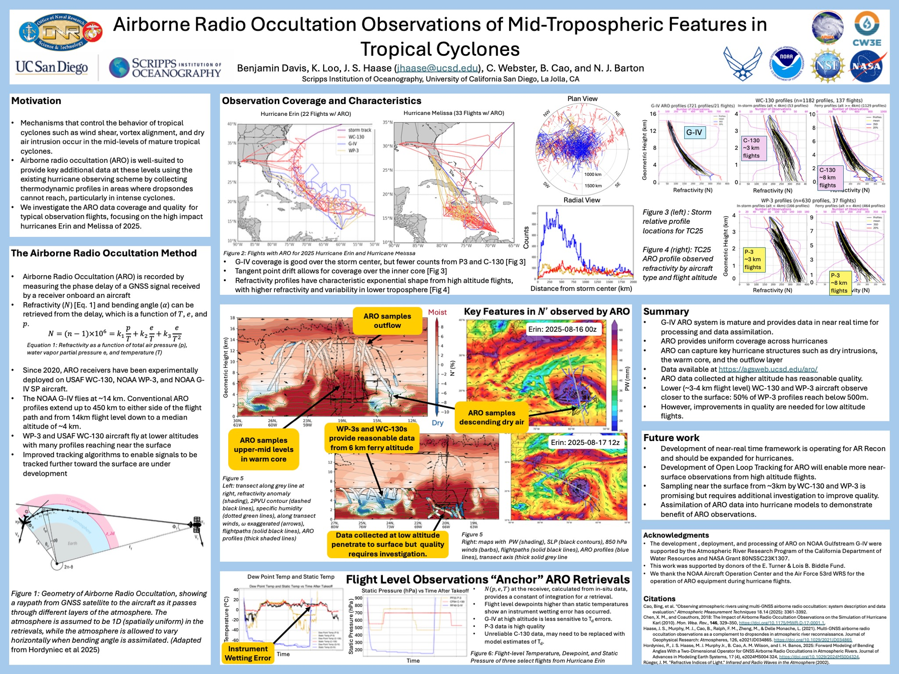
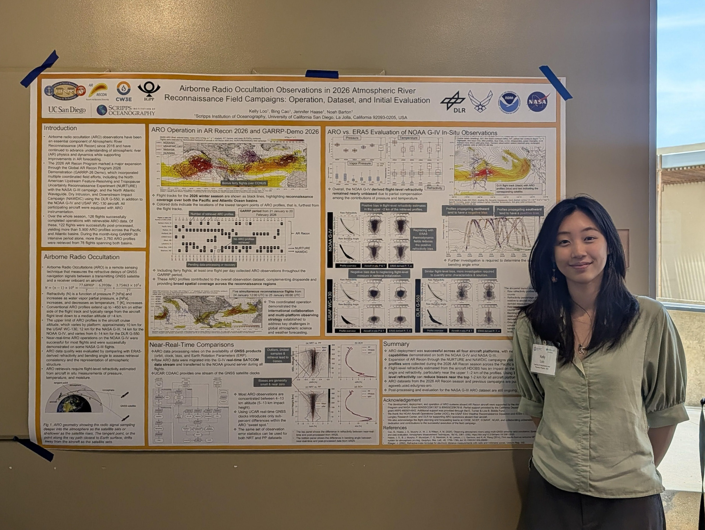
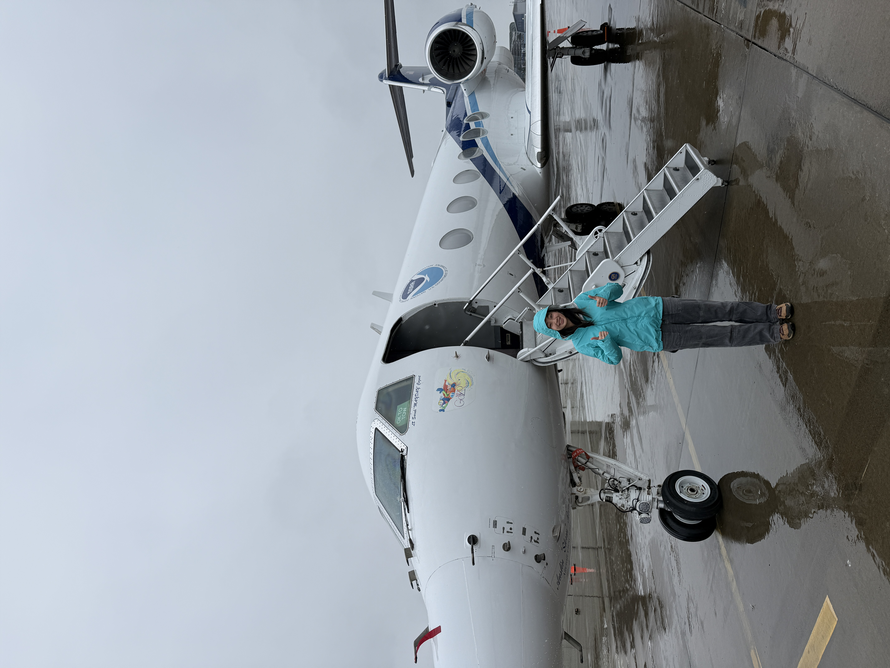

Hi! My name is Kelly Loo, and I am currently a master's student in Environmental Data Science at Bren.

## Experience
#### **Lab Assistant at Haase Lab, Scripps Institution of Oceanography**

I worked in Haase Lab, where I did data archiving, processing, and management. Our lab deploys airborne radio occultation receivers on Hurricane Hunter flights, creating atmospheric profiles of hurricanes and atmospheric rivers.

I performed data visualization and quality control in Python, plotting the refractivity from atmospheric profiles per flight (or campaign) in a height vs refractivity plot. I also used Bash for file organization, which was helpful due to the large database in the lab, as well as sharing databases with other agencies.

__Opportunities__

During my time at the lab, I had the priviledge to attend two conferences, and take a ride on one of the Hurricane Hunter flights!

:::: {layout="[0.45, 0.55]"}
:::{#firstcol}
{.lightbox}

{.lightbox}
:::
:::{#secondcol}
{.lightbox}
:::
::::

#### **Lifestyle Editor at The UCSD Guardian**
The UC San Diego Guardian is a student-led newspaper that are written by students, for students. I started as a writer for the Lifestyle section before becoming an editor my senior year. During my time with The UCSD Guardian, I developed skills in team collaboration, file organization, and producing articles on a tight deadline.

[Click here to find Kelly's works!](https://ucsdguardian.org/staff_name/kelly-loo/)

## Education
#### **M.S. in Environmental Data Science - University of California, Santa Barbara**

I am currently at the Bren School of Environmental Science and Management. I hope to develop skills in data visualization, remote sensing and mapping, and machine learning.

#### **B.S. in Geoscience (Honors) - University of California, San Diego**
*Honors thesis: Determining Indiana Loess Geographic Source Origin with Nd-Sr isotopic composition*

I attended the University of California, San Diego for my undergraduate studies. I knew that I wanted to be studying subjects related to the environment, and that I enjoyed physical science. That's how I ended up being a geoscientist! After taking Introduction to Geochemistry my second year, I was intrigued in the various elements dispersed around the planet. I got involved in a paleoclimatology lab, using chemistry to analyse the history of loess samples. However, when I entered my last year at UCSD, I dove into the geophysical world, and seismology captured my interest to round out my undergraduate career.