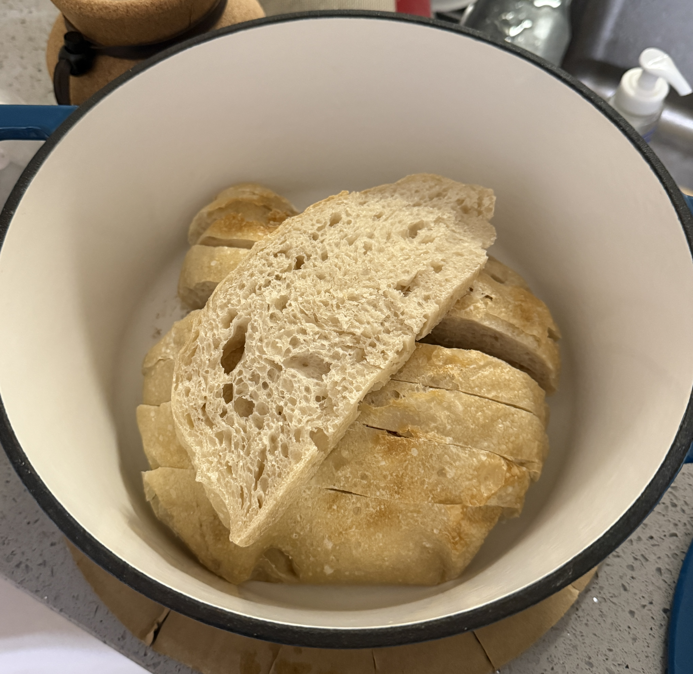
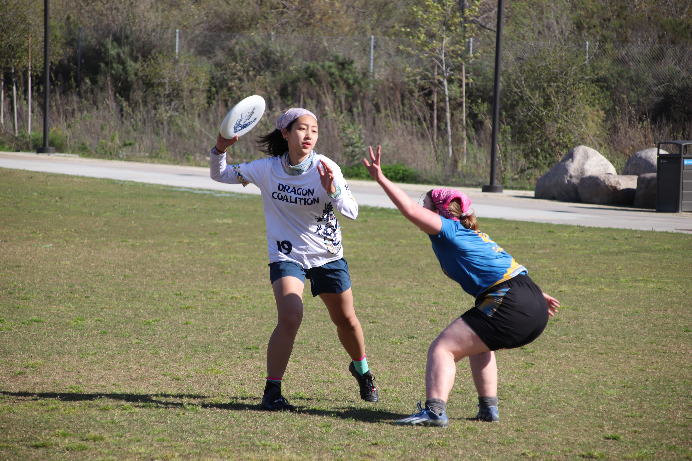
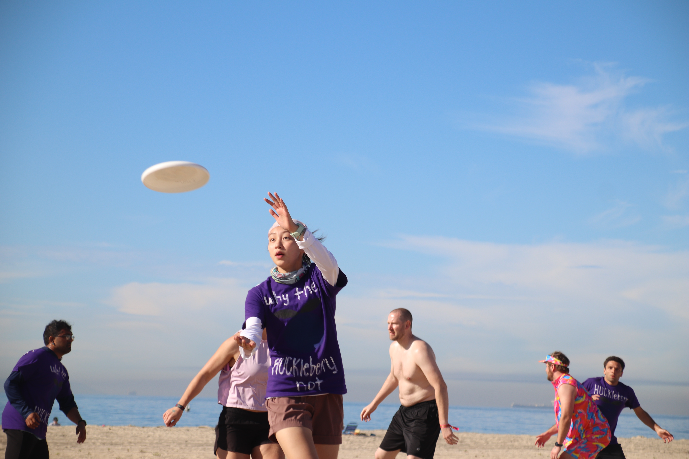

## Books
Reading has been a long standing hobby of mine, and it's something I try to do as often as I can because life can get in the way  I've made a list of some books I've really enjoyed reading, please take some inspiration to find your next read!

__Currently reading:__ The City and Its Uncertain Walls by Haruki Murakami

__Reads I've enjoyed:__

| Title | Author | Star Rating | One-line review |
|-------|--------|-------------|-----------------|
| Project Hail Mary | Andy Weir |  | This book scratches a good itch in my science brain. |
| Crying in H Mart | Michelle Zauner |  | Food is for sure a love language!! |
| 1984 | George Orwell |  | Winston’s character development was seamless, beautifully done by Big Brother. |
| Girl, Woman, Other | Bernadine Evaristo |  | It was an out of body experience. |
| Circe | Madeline Miller |  | Madeline Miller eats again. |
| Yellowface | R.F. Kuang |  | Does June like anyone besides herself? |
| The Beekeeper of Aleppo | Christy Lefteri |  | We learn that the characters from Aleppo have different coping mechanisms, and we can see them develop more throughout the book. |
| Seven Husbands of Evelyn Hugo | Taylor Jenkin Reid |  | Every detail, character, plot progression was so well planned out, anything less than a 5 star review is undeserving. |
| Song of Achilles | Madeline Miller |  | Miller did a good job at making the ending sad despite already giving us a preview on how the story ends in the middle of the story. |

: {.striped .hover}{tbl-colwidths="[20,15,20,40]"}

## Making sourdough
I've had my starter Stewie Jr., a descendant of my friend's starter Stewie, since 2025. Since then, I've been making bread for myself, friends, and family! I truly cannot remember the last time I bought a loaf of bread from the store.

Currently, I've just been making bread. Stay tuned for my pizza journey!

{fig-align='left' width=600px}

## Crocheting
~ work in progress ~

## Photography
~ work in progress ~
[Kelly's portfolio](https://neverbelikeyou.wixsite.com/photography)

## Playing Ultimate Frisbee
I was introduced to Ultimate in high school, where one of my coaches suggested I play in college. I took his advice, and being on the UCSD B-Co gave me the best four years I could've asked for!

I was honored to be captain for the last two years on the team, enhancing my communication skills between the school, my team, and coaches.

::: {layout="[[1,1], [1]]"}

:::
